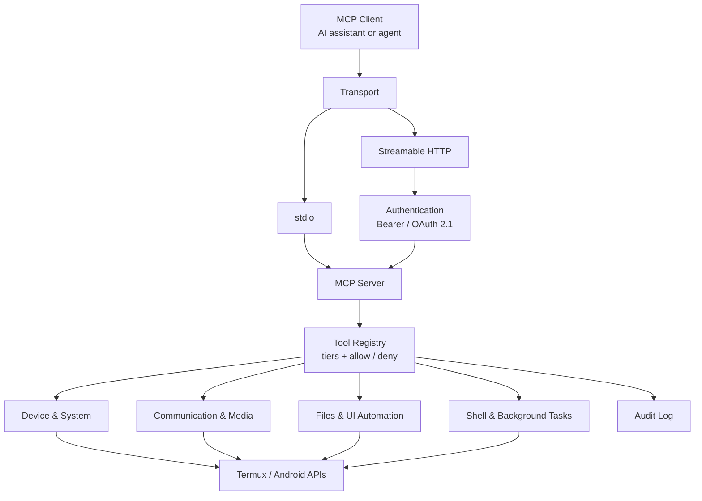

<!--
  termux-mcp · README
  Keep commands and configuration examples aligned with the implementation.
-->

<div align="center">

# ⌁ ᴛᴇʀᴍᴜx-ᴍᴄᴘ

### ʏᴏᴜʀ ᴀɴᴅʀᴏɪᴅ ᴅᴇᴠɪᴄᴇ. ʏᴏᴜʀ ᴀɪ ᴀɢᴇɴᴛ. ᴏɴᴇ ᴍᴄᴘ ʙʀɪᴅɢᴇ.

**Connect Termux and Android capabilities to AI assistants and MCP-compatible agents.**

<br/>

[](https://github.com/zema-tech/termux-mcp/actions/workflows/ci.yml)
[](https://go.dev/)
[](https://termux.dev/)
[](https://modelcontextprotocol.io/)
[](LICENSE)

[Demo](https://youtu.be/nLKPv9LPL1Y) · [Configuration](docs/CONFIGURATION.md) · [Remote access](docs/REMOTE_ACCESS.md) · [Security](docs/SECURITY.md)

</div>

---

## ✦ What is termux-mcp?

**termux-mcp** is a Go-based [Model Context Protocol (MCP)](https://modelcontextprotocol.io/) server that exposes selected Termux and Android capabilities to AI applications.

It creates a bridge between an MCP client and the tools available on your Android device: device information, communication, media, files, UI automation, command execution and background tasks.

Use it with a local agent over **stdio**, connect over your **LAN** with Streamable HTTP, or make it reachable remotely through a **Cloudflare quick tunnel**.

> Your Android device becomes a tool-enabled endpoint for your AI workflow. You choose the client, the enabled capabilities and the access model.

## ▶ Demo

<div align="center">

[](https://youtu.be/nLKPv9LPL1Y)

*Watch the project in action.*

</div>

## ✧ Highlights

| Capability | What it does |
|---|---|
| **9 tool modules** | Access device, communication, media, files, UI and task capabilities through MCP. |
| **Multiple transports** | Local stdio or Streamable HTTP for LAN and remote clients. |
| **Remote connectivity** | Cloudflare quick tunnels with token authentication or OAuth 2.1. |
| **Permission tiers** | Sensitive and dangerous modules can be gated independently. |
| **Filesystem sandbox** | File operations are restricted to configured roots and resolve symlinks. |
| **Background tasks** | Launch detached work and inspect task status or logs. |
| **Audit trail** | JSONL records with sensitive argument redaction. |
| **Termux integration** | Optional supervised service and Termux:Boot startup integration. |
| **Diagnostics and updates** | Built-in `doctor`, `version` and `update` commands. |

## 🧩 Tool modules

The server groups its tools into nine modules. Availability depends on the configured permission tiers and the Android/Termux capabilities installed on the device.

| Module | Access tier | Capabilities |
|---|---|---|
| **A · Device & System** | Safe | Battery, device information, storage, screen size, brightness, volume, vibration, flashlight, Wi-Fi, telephony and sensors. |
| **B · Communication** | Sensitive | SMS, contacts, call log, calls, notifications and toasts. |
| **C · Media** | Sensitive | Camera, audio recording, media player, text-to-speech and speech-to-text. |
| **D · Clipboard & Input** | Safe | Clipboard read/write, open URL and open app. |
| **E · Files** | Sensitive | List, read, write, download, share and media scan, subject to filesystem sandbox roots. |
| **F · UI Automation** | Dangerous | Screenshots, UI hierarchy dump, taps, swipes, text input and key events. |
| **G · Shell & Tasks** | Review carefully | Command execution, detached task launch, task status and task logs. |
| **H · Utility** | Safe | Ping, server status, configuration inspection and tool listing. |
| **I · Task Control** | Dangerous | Stop and delete background tasks. |

**Permission notes**

- Modules **B, C and E** require `tools.enable_sensitive: true`.
- Modules **F and I** require `tools.enable_dangerous: true` and applicable allow/deny rules.
- Shell execution is controlled separately through `exec.shell_allowed`, `exec.shell_allow_patterns` and `exec.shell_deny_patterns`. See the security warning below: the shipped configuration currently enables it with a wildcard allow pattern by default.

## ⚡ Installation

### Requirements

- Android device with [Termux](https://f-droid.org/packages/com.termux/) installed.
- [Termux:API](https://f-droid.org/packages/com.termux.api/) app installed from the same trusted source as Termux.
- Network access for installation and release downloads.
- Go **1.25.5 or newer** only if you build from source. The installer prefers a prebuilt release when one is available.

> Install Termux and Termux:API from the same source. Mixing distribution sources can cause signature and compatibility problems.

### One-command install

Run this **inside Termux**. The command below uses this repository's installer and explicitly tells it to install from this repository:

```bash
export TERMUX_MCP_REPO="https://github.com/zema-tech/termux-mcp.git"
curl -fsSL https://github.com/zema-tech/termux-mcp/raw/main/scripts/install.sh | bash
```

The installer is designed to:

1. Check that it is running inside Termux.
2. Install or verify required and optional packages.
3. Check the Termux:API bridge and request storage access when available.
4. Download a matching Android release binary, or fall back to a source build.
5. Create the configuration file without overwriting an existing one.
6. Generate and persist an authentication token when needed.
7. Register service and boot integration when the relevant Termux components are present.

**Installer options**

| Variable | Purpose |
|---|---|
| `TERMUX_MCP_REPO` | Git repository URL to install. Set this when using a fork. |
| `TERMUX_MCP_VERSION` | Release tag to install instead of the latest release. |
| `TERMUX_MCP_SOURCE=yes` | Skip the prebuilt binary and build from source. |
| `TERMUX_MCP_SERVICE=no` | Do not register the supervised service. |
| `TERMUX_MCP_BOOT=no` | Do not install the Termux:Boot entry. |

The installer may also offer optional packages such as `android-tools` and `cloudflared`. Review the script before running it if you want to inspect every installation action.

### Build from source

For a source build on Android, use an Android-targeted Go build:

```bash
pkg install -y golang git termux-api
git clone https://github.com/zema-tech/termux-mcp.git
cd termux-mcp

go mod download
GOOS=android go build -trimpath \
  -o "$PREFIX/bin/termux-mcp" ./cmd/termux-mcp

termux-mcp version
```

The Android target matters: the installer intentionally builds with `GOOS=android` for Termux compatibility.

## 🚀 First run

Check the device environment:

```bash
termux-mcp doctor
```

Start the server locally over stdio:

```bash
termux-mcp serve stdio
```

Or start the Streamable HTTP transport:

```bash
termux-mcp serve http
```

Useful commands:

| Command | Description |
|---|---|
| `termux-mcp doctor` | Inspect configuration, Termux commands and storage access. |
| `termux-mcp version` | Print the installed version. |
| `termux-mcp token new` | Generate a new bearer token. |
| `termux-mcp token new --write` | Generate and write a token to the configuration. |
| `termux-mcp token rotate` | Rotate the configured token. |
| `termux-mcp tunnel start` | Start a Cloudflare quick tunnel after its preflight checks. |
| `termux-mcp update` | Install the latest available release. |
| `termux-mcp update --version v0.2.0` | Install a specific release tag. |

Use `--config PATH` with supported commands when you need a non-default configuration file.

## 🔌 Connect an MCP client

### 1. Local connection · stdio

For an MCP client running on the same Termux environment:

```json
{
  "mcpServers": {
    "termux": {
      "command": "termux-mcp",
      "args": ["serve", "stdio"]
    }
  }
}
```

### 2. Local network · Streamable HTTP

Generate and persist a token:

```bash
termux-mcp token new --write
termux-mcp serve http --config "$PREFIX/var/lib/termux-mcp/config.yaml"
```

Then configure the client with the device's LAN address:

```json
{
  "mcpServers": {
    "termux": {
      "url": "http://192.168.1.20:3000/mcp",
      "headers": {
        "Authorization": "Bearer YOUR_TOKEN"
      }
    }
  }
}
```

Replace the example IP address and token with your own values. For LAN access, configure a non-loopback bind address and authentication in the server configuration.

### 3. Remote connection · Cloudflare quick tunnel

Start the HTTP server first:

```bash
termux-mcp serve http &
termux-mcp tunnel start
```

The tunnel command prints a public HTTPS URL. It performs a TCP preflight check and refuses to launch if the configured HTTP server is not listening.

Remote access requires authentication: configure a static token with `auth.require: true`, or enable OAuth. For OAuth-based clients, the server supports OAuth 2.1 discovery, dynamic client registration, PKCE S256 and an on-device consent step.

See **[Remote access](docs/REMOTE_ACCESS.md)** for complete static-token, OAuth and stdio-bridge examples, including the `mcp-remote` option for clients that only support stdio.

## ⚙ Configuration

The default configuration path is:

```text
$PREFIX/var/lib/termux-mcp/config.yaml
```

You can also set `TERMUX_MCP_CONFIG` or pass `--config PATH`. Environment variables using the `TERMUX_MCP_*` prefix override file values.

### Recommended starting profile

The following is a **hardened example**, not a copy of every shipped default. It keeps optional permission tiers disabled and turns shell execution off until you explicitly need it.

```yaml
server:
  mode: stdio
  bind: 127.0.0.1
  port: 3000

auth:
  token: ""
  require: false
  oauth: true

tools:
  enable_sensitive: false
  enable_dangerous: false
  allow: []
  deny: []
  file_roots:
    - /sdcard

exec:
  default_timeout_seconds: 30
  shell_allowed: false
  shell_allow_patterns: []
  shell_deny_patterns: []

audit:
  enabled: true

logging:
  level: info
  json: false
```

Protect the configuration file:

```bash
chmod 600 "$PREFIX/var/lib/termux-mcp/config.yaml"
```

For every available key, default value and environment override, consult **[docs/CONFIGURATION.md](docs/CONFIGURATION.md)**.

## 🛡 Security

This server can expose powerful capabilities on a personal device. Treat its configuration as an access-control boundary, not as a convenience setting.

### Important: shell execution default

The current `config.example.yaml` and configuration reference set:

- `exec.shell_allowed: true`
- `exec.shell_allow_patterns: [".*"]`

That combination allows command execution unless restricted by other configured controls. **Do not assume shell access is disabled by default.** For a least-privilege setup, explicitly set `shell_allowed: false` or replace the wildcard with narrow command patterns that you have reviewed.

### Security controls

- Sensitive and dangerous tool tiers are separately gated.
- Non-loopback HTTP binds require authentication.
- Public tunnels require a configured authentication mechanism.
- Bearer tokens are compared in constant time.
- Configuration files are intended to be private (`chmod 600`).
- File operations are constrained to configured roots and resolve symlinks.
- Command execution has configurable timeouts and output limits.
- Audit events are written as JSONL with sensitive argument redaction.
- OAuth access tokens are opaque, held in process memory and expire; they are not persistent across server restarts.

### Before exposing your device remotely

1. Set up a strong token with `termux-mcp token new --write`, or configure OAuth.
2. Keep sensitive and dangerous modules disabled unless you have a concrete need.
3. Disable shell execution or use a narrowly scoped allowlist.
4. Keep the configuration file private and never publish tokens in logs, screenshots or issue reports.
5. Review the audit log and revoke/rotate credentials if exposure is suspected.

Read the complete **[Security model](docs/SECURITY.md)** before enabling remote access.

## 🏗 Architecture

At a high level, requests pass through the MCP transport, authentication and tool registry before reaching the relevant Termux/Android integration.



### Repository map

```text
.
├── cmd/termux-mcp/       CLI entry point
├── internal/
│   ├── config/           YAML config, env overrides and validation
│   ├── registry/         Tool catalog, permission tiers and filtering
│   ├── exec/             Command execution controls
│   ├── audit/            JSONL audit logging and redaction
│   ├── auth/             Bearer authentication
│   ├── server/           stdio and Streamable HTTP transports
│   ├── tasks/            Background task management
│   ├── tools/            Device and Android tool modules
│   ├── tunnel/           Cloudflare quick tunnel integration
│   └── version/          Build version metadata
├── scripts/              Installer and boot/service scripts
├── docs/                 Configuration, remote access and security
├── config.example.yaml   Example server configuration
└── .github/workflows/    Continuous integration
```

## 🧪 Development

### Prerequisites

- Go version declared by the project in `go.mod` (currently Go 1.25.5).
- Git.
- A Termux/Android device for integration checks involving Android APIs. The unit test suite also includes shell-based command fixtures and does not require a device.

### Get the code

```bash
git clone https://github.com/zema-tech/termux-mcp.git
cd termux-mcp
go mod download
```

### Validate your changes

Run the same core checks used by the repository's GitHub Actions workflow:

```bash
# Check formatting
unformatted="$(gofmt -l .)"
if [ -n "$unformatted" ]; then
  printf 'Go files need gofmt:\n%s\n' "$unformatted"
  exit 1
fi

# Static analysis, tests and build
go vet ./...
go test ./...
go build ./...
```

The CI workflow runs on pushes and pull requests targeting `main`, and can also be started manually.

### Contribution workflow

1. Create a focused branch from `main`.
2. Keep changes scoped and document user-visible behavior.
3. Run formatting, vet, tests and build locally.
4. Open a pull request with a concise summary, test results and any security implications.

For security-sensitive changes, explain the threat model and the effect on default permissions.

## 🧰 Troubleshooting

| Symptom | What to check |
|---|---|
| `termux-mcp: command not found` | Confirm the binary is installed in `$PREFIX/bin` and that `$PREFIX/bin` is on your PATH. |
| Android tools are missing | Install Termux:API from the same source as Termux, open it and grant the required Android permissions. |
| Battery, SMS or camera tools do not respond | Run `termux-mcp doctor`, check Termux:API permissions and Android battery restrictions. |
| Storage access is unavailable | Run `termux-setup-storage` and verify the configured `tools.file_roots`. |
| HTTP client cannot connect | Check `server.mode`, `server.bind`, `server.port`, device LAN address and firewall/network isolation. |
| Remote tunnel refuses to start | Start `termux-mcp serve http` first and verify token authentication or OAuth configuration. |
| A tool is not listed | Check its permission tier and `tools.allow` / `tools.deny` configuration. |
| A command is rejected | Inspect `exec.shell_allowed`, allow patterns and deny patterns. |

For deeper configuration and remote-access issues, start with the [configuration guide](docs/CONFIGURATION.md) and [remote-access guide](docs/REMOTE_ACCESS.md).

## 📚 Documentation

- **[Configuration reference](docs/CONFIGURATION.md)** · paths, defaults and environment variables.
- **[Remote access](docs/REMOTE_ACCESS.md)** · LAN, Cloudflare tunnels, OAuth and client setup.
- **[Security model](docs/SECURITY.md)** · permission tiers, authentication, sandboxing and audit redaction.

## 🗺 Project status

The repository evolves alongside its implementation. Check the [open issues](https://github.com/zema-tech/termux-mcp/issues), [pull requests](https://github.com/zema-tech/termux-mcp/pulls) and [Actions](https://github.com/zema-tech/termux-mcp/actions) for current development activity.

Feature availability can depend on Android version, Termux packages, granted permissions and client transport support.

## 📄 License

Distributed under the **MIT License**. See [LICENSE](LICENSE).

---

<div align="center">

**termux-mcp** · Connect your device to your agentic workflow.

<sub>Built with Go · Designed for Termux · Powered by MCP</sub>

</div>
